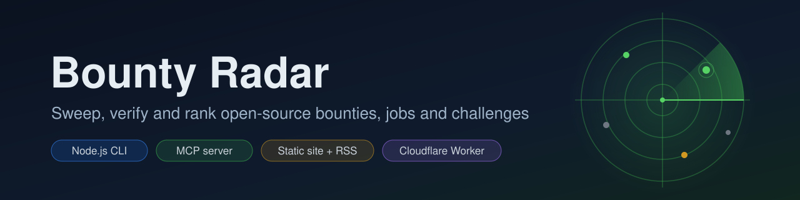
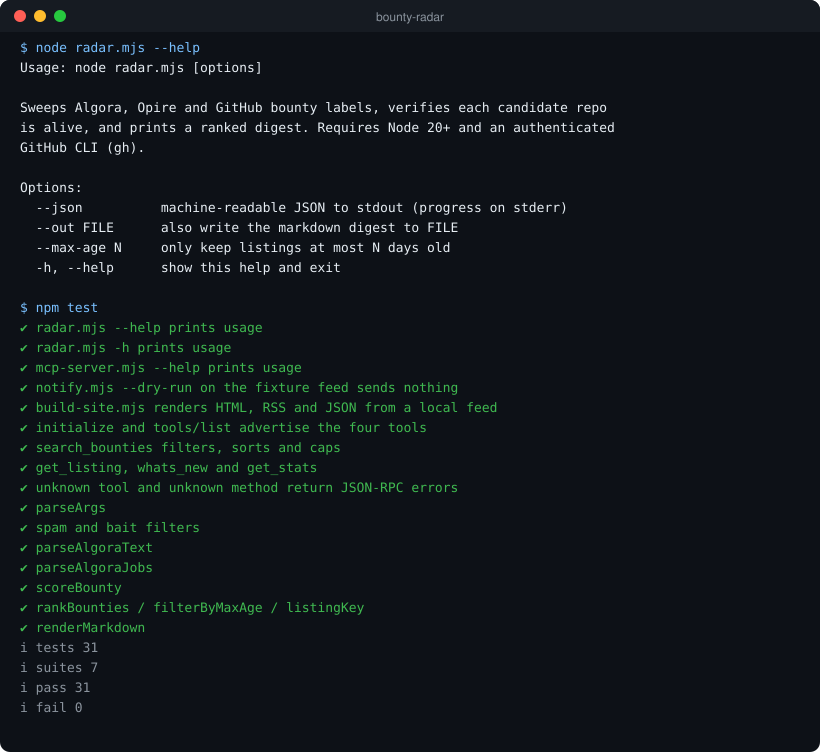
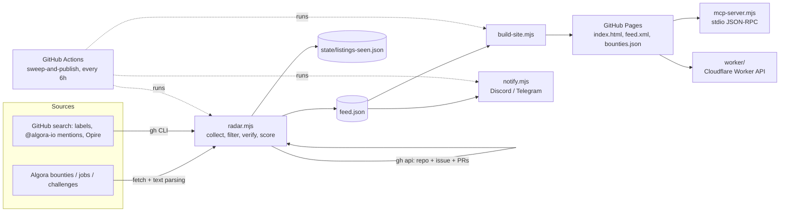

<p align="center">
  
</p>

<p align="center"><b>Sweep, verify and rank open-source bounties, jobs and challenges.</b></p>

<p align="center">
  <a href="LICENSE"></a>
  
  <a href="https://muhib-karim.github.io/bounty-radar/"></a>
  <a href="https://github.com/muhib-karim/bounty-radar/actions/workflows/ci.yml"></a>
</p>

Bounty Radar is a zero-dependency Node.js toolkit that collects open-source bounty listings, checks that the repository behind each one is still alive, filters known spam patterns, and ranks what is left with a simple, explainable score. The same feed is published as a static HTML board, RSS and JSON, and exposed to AI coding agents through an MCP server.

## Key features

- **Six collectors** in `radar.mjs`: Algora org bounty pages, Algora jobs pages, Algora challenges, GitHub issues that mention `@algora-io`, Opire rewards found via GitHub search, and GitHub issues carrying common bounty labels.
- **Liveness verification** through the GitHub CLI: drops archived repos, bounties on forks (for label-sourced issues), repos not pushed within 60 days and issues that are no longer open; counts open PRs that compete for the same issue.
- **Spam and bait filtering**: regex blocklist for known fake-bounty repos/orgs and a filter for the copy-pasted `[Bounty: $X]` title template.
- **Deterministic scoring**: points for amount, freshness, claim count, competing PRs and recent repo activity; duplicates are merged keeping the highest amount.
- **Outputs**: Markdown digest, JSON (`--json`), and a static site (`build-site.mjs`) with `index.html`, `feed.xml` (RSS 2.0) and `bounties.json`.
- **MCP server** (`mcp-server.mjs`): JSON-RPC 2.0 over stdio with four tools (`search_bounties`, `get_listing`, `whats_new`, `get_stats`). Reads the published feed or a local `feed.json`.
- **Alerts** (`notify.mjs`): Discord and/or Telegram messages for new listings above a score threshold, with de-duplication state and a `--dry-run` mode.
- **Optional API** (`worker/`): a Cloudflare Worker serving `/v1/listings`, `/v1/diff`, `/v1/sources`, `/v1/stats` and an OpenAPI document, with KV-backed API keys and per-IP rate limits.
- **Automation**: a scheduled GitHub Actions workflow sweeps every 6 hours, rebuilds the site, deploys GitHub Pages and commits tracking state.

## Demo

A real terminal session (CLI help and the test suite), rendered to SVG from actual command output:

<p align="center"></p>

The board screenshot below is **historical**. It shows what the generated site looks like, not current listings or availability.


### Live board

The scheduled pipeline publishes the board to GitHub Pages: **https://muhib-karim.github.io/bounty-radar/** (checked 13 October 2026: HTTP 200, `bounties.json` generated 2026-10-12 23:52 UTC). The old `ai-dev-2024.github.io` address from before the account rename no longer resolves, and the optional Cloudflare Worker API returned HTTP 502 in an 11 October 2026 check, so it is not advertised as live.

Filters reduce noise; they do not guarantee that a listing is payable, unclaimed or still available. Always re-check the original listing before investing time.

## Quick start

Requirements: Node.js 20 or newer. The live sweep (`radar.mjs`) also needs the [GitHub CLI](https://cli.github.com/) (`gh`) authenticated with read access. Tests need neither network nor `gh`.

```bash
git clone https://github.com/muhib-karim/bounty-radar.git
cd bounty-radar
npm test          # no install step: there are no runtime dependencies
```

## Usage

```bash
node radar.mjs --help                # options
node radar.mjs                       # Markdown digest to stdout
node radar.mjs --json > feed.json    # JSON feed (progress on stderr)
node radar.mjs --out digest.md       # also write the digest to a file
node radar.mjs --max-age 14          # only listings at most 14 days old

node build-site.mjs feed.json site   # site/index.html, feed.xml, bounties.json
node notify.mjs feed.json --dry-run  # show which alerts would fire, send nothing
```

Note: `radar.mjs` writes `state/listings-seen.json` (first/last-seen timestamps) on every sweep.

### MCP server

```bash
node mcp-server.mjs --help
node mcp-server.mjs feed.json        # serve a local feed over stdio
```

Agent configuration:

```json
{ "mcpServers": { "bounty-radar": { "command": "node", "args": ["/path/to/bounty-radar/mcp-server.mjs"] } } }
```

Without a file argument the server fetches the feed from `BOUNTY_RADAR_FEED` (defaults to the project's GitHub Pages `bounties.json`).

### Alerts

Set `DISCORD_WEBHOOK_URL` and/or `TELEGRAM_BOT_TOKEN` + `TELEGRAM_CHAT_ID` in the environment, then run `node notify.mjs feed.json`. Use `--dry-run` first. Never commit webhook URLs or tokens.

## Architecture



- `radar.mjs` is the core. Its pure logic (argument parsing, HTML-text parsers, spam/bait filters, scoring, ranking, Markdown rendering) is exported for tests; the network sweep runs only when the file is executed directly.
- `build-site.mjs` turns a feed into a static site; if the feed is missing or older than 20 hours it runs a fresh sweep first.
- `mcp-server.mjs` and `worker/` are read-only consumers of the published `bounties.json`.
- `hn-monitor.mjs`, `launch-digest.mjs`, `build-dashboard.mjs` and `preflight.mjs` are launch-time helpers (Hacker News thread monitoring, digests and a pre-launch link checker).

## Testing

```bash
npm run check   # node --check on every script (syntax)
npm test        # node:test: unit, MCP protocol and CLI smoke tests
```

The suite has 31 tests and runs offline against a fixture feed (`test/fixtures/feed.json`):

- `test/radar.test.mjs`: argument parsing, spam/bait filters, Algora text parsers, scoring tiers, ranking, max-age filtering, listing ids, Markdown rendering.
- `test/mcp-server.test.mjs`: spawns the MCP server and drives it over stdio (`initialize`, `tools/list`, every tool, error codes).
- `test/cli.test.mjs`: `--help` smoke tests, `notify.mjs --dry-run`, and a full `build-site.mjs` render into a temp directory.

CI (`.github/workflows/ci.yml`) runs both commands on Node 20 and 22.

## Project structure

```text
radar.mjs               core sweep: collectors, verification, scoring, digest
build-site.mjs          static HTML / RSS / JSON generator
mcp-server.mjs          MCP server (stdio, JSON-RPC 2.0)
notify.mjs              Discord / Telegram alerts with dedup state
hn-monitor.mjs          Hacker News thread + PR watcher (launch helper)
launch-digest.mjs       hourly launch-day digest (launch helper)
build-dashboard.mjs     launch dashboard SVG
build-social-banner.mjs social preview image generator
render-chart.mjs        SVG to PNG via sharp (CI only)
preflight.mjs           pre-launch link and claim checker
worker/                 optional Cloudflare Worker API (wrangler)
state/                  tracking state committed by the scheduled workflows
test/                   node:test suites and fixture feed
docs/                   banner, screenshots, launch notes
.github/workflows/      ci, sweep-and-publish, hn-monitor, launch-digest
```

## Limitations

- Algora pages are parsed from rendered HTML text, so a markup change on their side can silently reduce results.
- Opire listings are only included when the amount appears in the issue title; the Opire platform itself was returning 502 in September 2026, so claims may not be possible.
- Escrow is not verified for GitHub-label or mention sources; those listings are marked `unknown`.
- Verification uses several GitHub API calls per candidate and is subject to `gh` rate limits.
- The scheduled workflows have side effects (Pages deploys, state commits, alert webhooks). Review them before running manually in a fork.

## License

[MIT](LICENSE). Source data and linked opportunities retain their own terms.
