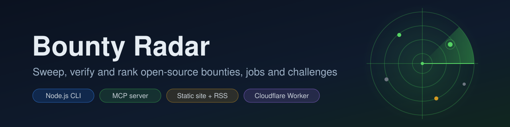
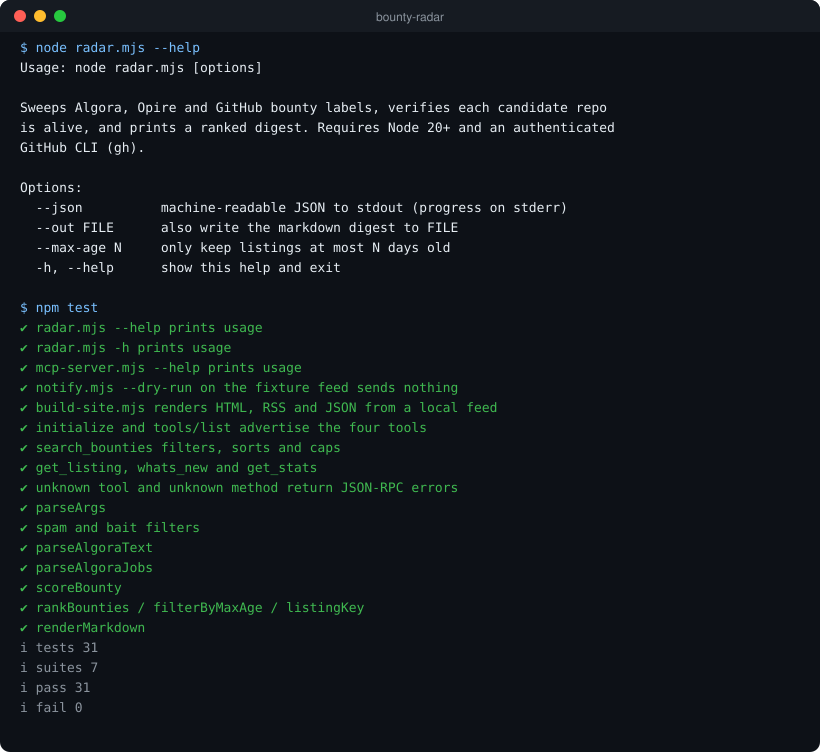
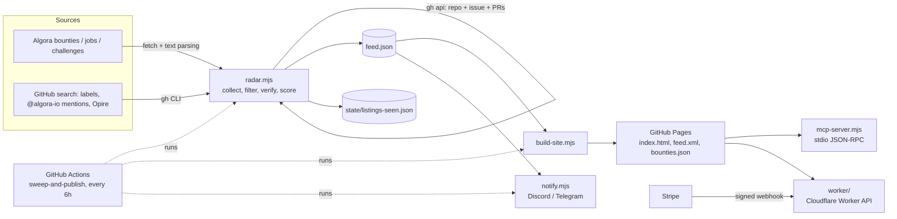

<p align="center">
  
</p>

<p align="center"><b>Sweep, verify and rank open-source bounties, jobs and challenges.</b></p>

<p align="center">
  <a href="https://github.com/muhib-karim/bounty-radar/actions/workflows/ci.yml"></a>
  <a href="https://github.com/muhib-karim/bounty-radar/blob/main/LICENSE"></a>
  
  <a href="https://muhib-karim.github.io/bounty-radar/"></a>
</p>

## What it is

Bounty Radar is a zero-dependency Node.js toolkit that collects open-source bounty listings, checks that the repository behind each one is still alive, filters known spam patterns, and ranks what is left with a simple, explainable score. The same feed is published as a static HTML board, RSS and JSON, exposed to AI coding agents through an MCP server, and optionally served by a Cloudflare Worker API with API keys and paid plans.

- **Six collectors** in `radar.mjs`: Algora org bounty pages, Algora jobs pages, Algora challenges, GitHub issues that mention `@algora-io`, Opire rewards found via GitHub search, and GitHub issues carrying common bounty labels.
- **Liveness verification** through the GitHub CLI: drops archived repos, bounties on forks (for label-sourced issues), repos not pushed within 60 days and issues that are no longer open; counts open PRs that compete for the same issue.
- **Spam and bait filtering**: a regex blocklist for known fake-bounty repos/orgs and a filter for the copy-pasted `[Bounty: $X]` title template.
- **Deterministic scoring** from 0 to 12 (see [Scoring](#scoring)); duplicates are merged keeping the highest amount.
- **Outputs**: Markdown digest, JSON (`--json`), and a static site (`build-site.mjs`) with `index.html`, `feed.xml` (RSS 2.0) and `bounties.json`.
- **MCP server** (`mcp-server.mjs`): JSON-RPC 2.0 over stdio with four tools.
- **Alerts** (`notify.mjs`): Discord and/or Telegram messages for new listings above a score threshold, tracked per channel.
- **Optional API** (`worker/`): a Cloudflare Worker with KV-backed API keys, daily quotas and Stripe-paid plans.
- **Automation**: a scheduled GitHub Actions workflow sweeps every 6 hours, rebuilds the site, deploys GitHub Pages and commits tracking state.

The board is published at **https://muhib-karim.github.io/bounty-radar/**. Filters reduce noise; they do not guarantee that a listing is payable, unclaimed or still available. Always re-check the original listing before investing time.

<p align="center"></p>

The screenshot below is **historical**. It shows what the generated site looks like, not current listings.


## Quickstart

Requirements: Node.js 20 or newer. A live sweep also needs the [GitHub CLI](https://cli.github.com/) (`gh`) authenticated with read access. The tests need neither network nor `gh`.

```bash
git clone https://github.com/muhib-karim/bounty-radar.git
cd bounty-radar
npm test                             # no install step: there are no runtime dependencies

node radar.mjs --json > feed.json    # sweep (needs network + gh); progress goes to stderr
node build-site.mjs feed.json site   # site/index.html, feed.xml, bounties.json
```

## Usage

```bash
node radar.mjs --help                # options
node radar.mjs                       # Markdown digest to stdout
node radar.mjs --json > feed.json    # JSON feed
node radar.mjs --out digest.md       # also write the digest to a file
node radar.mjs --max-age 14          # only listings at most 14 days old

node build-site.mjs feed.json site   # static site from a feed
node notify.mjs feed.json --dry-run  # show which alerts would fire, send nothing
```

Each of the six sources reports success or failure; failures are listed on stderr. Exit codes of `radar.mjs`:

| Outcome | Exit | Output |
| --- | --- | --- |
| No source failed (even if nothing was found) | 0 | feed or digest |
| Some sources failed, listings were still found | 0 | feed or digest, failures on stderr |
| Some sources failed and no listing survived | 1 | nothing on stdout, no state written |
| Every source failed | 1 | nothing on stdout, no state written |

An empty result next to failed sources cannot be told apart from an outage, so it is never published as an empty board. `build-site.mjs` runs a sweep itself when the feed file is missing or older than 20 hours, and stops without writing a site if that sweep fails.

`radar.mjs` writes `state/listings-seen.json` (first/last-seen timestamps) relative to the current directory on every successful sweep.

### Alerts

Set `DISCORD_WEBHOOK_URL` and/or `TELEGRAM_BOT_TOKEN` + `TELEGRAM_CHAT_ID`, then run `node notify.mjs feed.json`. Use `--dry-run` first. Never commit webhook URLs or tokens.

Delivery is tracked per listing and per channel in the state file (`--state`, default `state/alerts-state.json` next to the feed):

- A channel is recorded only after its own send succeeded. If Telegram fails after Discord succeeded, the next run retries Telegram only.
- One message carries at most 10 listings. Only the listings actually sent are recorded; the rest go out on the next run.
- Exit code 0 means everything pending was sent (or there was nothing to send), 1 means at least one channel failed, 2 means no channel is configured.

## Use it from any agent (MCP server)

```bash
node mcp-server.mjs --help
node mcp-server.mjs feed.json        # serve a local feed over stdio
```

Agent configuration:

```json
{ "mcpServers": { "bounty-radar": { "command": "node", "args": ["/path/to/bounty-radar/mcp-server.mjs"] } } }
```

Without a file argument the server fetches the feed from `BOUNTY_RADAR_FEED` (default: the published `bounties.json`) and caches it for `FEED_CACHE_TTL_MS`.

| Tool | What it does |
| --- | --- |
| `search_bounties` | Filter by `min_score`, `min_amount`, `max_age_days`, `source`, `type`, `escrow_only`, `q`; sort by score, amount or freshness. `limit` is clamped to 1–100 (default 20). |
| `get_listing` | Full details and verification status for one listing id. |
| `whats_new` | Listings the feed **first saw** after `since`. Pass the `feed_generated_at` from your previous call. |
| `get_stats` | Listing count, total known USD, median score, per-source breakdown. |

## Architecture



- `radar.mjs` is the core. Its logic (argument parsing, HTML-text parsers, spam/bait filters, scoring, ranking, Markdown rendering, running the sources) is exported for tests; the network sweep runs only when the file is executed directly.
- `build-site.mjs` turns a feed into a static site. RSS item guids are derived from the listing URL (plus the listing key where several listings share a page), so they stay the same when the ranking changes.
- `mcp-server.mjs` and `worker/` are read-only consumers of the published `bounties.json`.
- `hn-monitor.mjs`, `launch-digest.mjs`, `build-dashboard.mjs`, `build-social-banner.mjs` and `preflight.mjs` are launch-time helpers (Hacker News thread monitoring, digests, charts and a pre-launch link checker).

### Scoring

`scoreBounty()` in `radar.mjs` adds points up to a maximum of **12** (`MAX_SCORE`):

| Signal | Points |
| --- | --- |
| Amount: ≥ $1,000 / ≥ $250 / ≥ $100 / ≥ $30 | 4 / 3 / 2 / 1 |
| Age: ≤ 3 days / ≤ 14 days / ≤ 60 days | 3 / 2 / 1 |
| Claims: none / 1–2 | 2 / 1 |
| No open PR competing for the issue | 2 |
| Repository pushed within the last 7 days | 1 |

Jobs and challenges have no issue to measure, so they get fixed scores: jobs 7, challenges 8 (9 when the prize is $5,000 or more).

## Worker API setup

`worker/` is an optional Cloudflare Worker that serves the feed as a queryable API. It has no dependencies; `wrangler` is only needed to deploy it. The launch scripts default to the instance at `https://bounty-radar-api.ai-dev-2024.workers.dev` (a Cloudflare account subdomain, unrelated to the repository owner's GitHub name); override it with `LAUNCH_API_URL`.

### Deploy

```bash
cd worker
npm ci                                        # installs wrangler
npx wrangler login
npx wrangler kv namespace create KEYS         # prints an id
npx wrangler kv namespace create SNAPSHOTS    # prints an id
```

Put the two ids into `worker/wrangler.toml` (the ids committed there belong to the original deployment), check the `[vars]` block, then:

```bash
npx wrangler secret put STRIPE_SECRET         # only if you sell paid plans, see Stripe below
npx wrangler deploy
```

For local development use `npx wrangler dev` and put secrets in `worker/.dev.vars` (git-ignored).

### Endpoints

| Endpoint | Metered | Notes |
| --- | --- | --- |
| `GET /v1/listings` | yes | Filters as in the MCP `search_bounties` tool. `limit` is clamped to 1–100 (default 50). Returns an `ETag` that is specific to the query and the sweep; send it back as `If-None-Match` for a `304`. |
| `GET /v1/listings/{id}` | yes | `id` URL-encoded, e.g. `acme%2Fwidgets%2312`. Invalid percent-encoding is a `400`. |
| `GET /v1/diff?since=` | yes | Added, changed and removed listings since `meta.generated_at` of an earlier response. |
| `GET /v1/sources`, `GET /v1/stats` | yes | Per-source counts; market summary. |
| `GET /v1/keys/me` | yes | Plan, usage and limit of the calling key. |
| `POST /v1/keys` | no | Creates a free key. At most 5 per IP per day. |
| `POST /v1/webhooks/stripe` | no | Stripe events; authenticated by signature. |
| `GET /`, `/openapi.json`, `/v1/launch` | no | Index, OpenAPI 3 document, launch dashboard data. |

Authenticate with `Authorization: Bearer brk_…`. Metered responses carry `X-RateLimit-Limit` and `X-RateLimit-Remaining`; a `429` adds `Retry-After` (seconds until the UTC-midnight reset). A feed that cannot be fetched is a `502`.

| Caller | Requests per UTC day |
| --- | --- |
| Anonymous (per IP) | `FREE_DAILY_LIMIT` (100) |
| Free key | 10 × `FREE_DAILY_LIMIT` (1,000) |
| `agent` plan | 5,000 |
| `team` plan | 25,000 |

### Quota and Workers KV limits

Workers KV is the only storage the Worker uses, and KV cannot implement a counter on its own:

| KV property | Consequence |
| --- | --- |
| No atomic increment or compare-and-swap | A read-check-write per request is a race: parallel requests all read the same value. |
| Eventually consistent (a write can take 60 s or more to be visible elsewhere; reading your own write back is not guaranteed) | A counter read from KV can be stale. |
| 1 write per second to the same key | Writing the counter on every request fails under any burst. |
| Free plan: 1,000 writes and 100,000 reads per day | Per-request writes exhaust the plan within 1,000 API calls. |

So the counter that decides is held in memory, one per client per isolate, and its check-and-increment runs without yielding. Inside one isolate that is exact: 300 parallel requests against a limit of 100 let exactly 100 through. KV seeds the counter when an isolate first sees a client, and receives coalesced write-behind updates (at most one write per client per `QUOTA_FLUSH_MS`).

What this does **not** provide is one global counter. Cloudflare may run several isolates, in several locations, and each enforces the limit against its own view; they learn about each other only through KV. A client whose requests are spread across isolates can therefore exceed the limit by roughly the number of isolates times the requests made within the flush and sync windows, and increments that were not flushed yet are lost if an isolate is killed. If reading or writing a counter fails, the Worker keeps serving and counts in memory only (requests with an API key still need KV to look the key up). Exact global enforcement needs a Durable Object or Cloudflare's Rate Limiting binding; this Worker deliberately uses neither. On the free KV plan, write-behind stops persisting once the daily write allowance is used up.

A new or changed API key record can also take up to about a minute to be visible in every location, because KV caches lookups (including "not found").

### Stripe (paid plans)

Paid plans use Stripe Payment Links and one webhook; there is no Stripe SDK and no Stripe API key in the Worker.

1. **Create two Payment Links** in Stripe, one per plan. On each link set the metadata `plan` to `agent` or `team`. Stripe copies it to the Checkout Session.
2. **Tell the Worker about them**: set `CHECKOUT_URL_AGENT` and `CHECKOUT_URL_TEAM` to the two link URLs. `POST /v1/keys` and `GET /v1/keys/me` return them with `?client_reference_id=<the caller's key>` appended. That parameter is how a payment is matched to a key, so send customers to the URL the API returns, not to the bare link.
3. **Create a webhook endpoint** in Stripe pointing at `https://<your-worker>/v1/webhooks/stripe`. Choose the **snapshot** payload style (the handler reads `data.object`, which thin events do not carry, so thin events are acknowledged and ignored) and subscribe to exactly `checkout.session.completed` and `invoice.paid`.
4. **Store the endpoint's signing secret** (it starts with `whsec_`): `npx wrangler secret put STRIPE_SECRET`. This is the webhook signing secret, not a Stripe API key. Without it the endpoint answers `501`.

How the webhook behaves:

- **Signature**: HMAC-SHA256 over `timestamp.body` is checked against every `v1` signature in the `Stripe-Signature` header (there are several while a secret is being rolled). Anything else is a `400`.
- **Replay window**: the signed timestamp must be within **300 seconds** of the Worker's clock, in either direction.
- **Idempotency**: each event id is applied once. Ids are remembered in KV for 35 days (Stripe allows manual resends for 30) and a repeat is answered `200 {"received": true, "duplicate": true}`. The grant itself is also idempotent, because it is computed from the event's own timestamp rather than from the time of delivery.
- **`checkout.session.completed`** sets the key's plan and `paid_until` to the event time plus 31 days. An unknown plan or a session without a key is a `400`, an unknown key a `404`; Stripe retries those, so they show up in its dashboard.
- **`invoice.paid`** (subscription renewals) extends `paid_until` to the end of the invoice's billing period plus one day of grace. Events can arrive in any order; an invoice that arrives before its checkout event is held and applied when the checkout arrives.
- **Expiry**: a paid plan counts only while `paid_until` is in the future. After that the key is treated as a free key (`/v1/keys/me` reports `plan_expired: true`) until another payment arrives. A paid plan with no `paid_until` is treated as expired.
- The webhook is not rate-limited and does not consume quota.

To test locally: `stripe listen --forward-to localhost:8787/v1/webhooks/stripe` (use the signing secret it prints as `STRIPE_SECRET` in `worker/.dev.vars`), then `stripe trigger checkout.session.completed --add checkout_session:client_reference_id=<key> --add checkout_session:metadata.plan=agent`.

## Configuration

Every environment variable the code reads. None is required for `npm test`.

### Scripts

| Variable | Read by | Purpose | Default |
| --- | --- | --- | --- |
| `SITE_URL` | `build-site.mjs`, `preflight.mjs` | Public URL of the published site, with trailing slash | `https://muhib-karim.github.io/bounty-radar/` |
| `HN_ITEM_ID` | `build-site.mjs`, `build-dashboard.mjs`, `hn-monitor.mjs`, `launch-digest.mjs` | Hacker News item to link, chart and monitor | unset (launch features off) |
| `BOUNTY_RADAR_FEED` | `mcp-server.mjs` | Feed URL for the MCP server | the published `bounties.json` |
| `FEED_CACHE_TTL_MS` | `mcp-server.mjs` | How long the MCP server caches the feed | `600000` |
| `DISCORD_WEBHOOK_URL` | `notify.mjs`, `hn-monitor.mjs`, `launch-digest.mjs` | Discord webhook to post to (secret) | unset |
| `TELEGRAM_BOT_TOKEN` | `notify.mjs`, `hn-monitor.mjs` | Telegram bot token (secret) | unset |
| `TELEGRAM_CHAT_ID` | `notify.mjs`, `hn-monitor.mjs` | Telegram chat to message | unset |
| `LAUNCH_API_URL` | `build-dashboard.mjs`, `launch-digest.mjs`, `preflight.mjs` | Base URL of the Worker API | `https://bounty-radar-api.ai-dev-2024.workers.dev` |
| `GH_DASHBOARD_REPO` | `hn-monitor.mjs`, `launch-digest.mjs`, `preflight.mjs` | Repository whose stars are tracked | `muhib-karim/bounty-radar` |
| `GH_AUTHOR` | `hn-monitor.mjs` | GitHub login whose open pull requests are watched | `muhib-karim` |
| `GH_TOKEN`, `GITHUB_TOKEN` | `hn-monitor.mjs`, and the `gh` CLI everywhere | GitHub authentication; either one enables pull-request monitoring | `gh`'s stored login |
| `GITHUB_REPOSITORY` | `hn-monitor.mjs` | Set by GitHub Actions; repository to dispatch follow-up runs to | unset |
| `GH_EVENT_NAME` | `hn-monitor.mjs` | Set by the workflow to the triggering event; only `schedule` runs dispatch a follow-up | unset |
| `FOLLOWUP` | `hn-monitor.mjs` | `1` makes the run wait 90 s before polling (follow-up runs) | unset |
| `DIGEST_MAX_AGE_HOURS` | `launch-digest.mjs` | Stop sending digests once the thread is older than this | `36` |
| `DASHBOARD_API_FILE` | `build-dashboard.mjs` | Read `/v1/launch` data from a file instead of the API (testing) | unset |
| `SOCIAL_BANNER_FEED_URL` | `build-social-banner.mjs` | Feed used for the numbers on the social banner | the published `bounties.json` |

### GitHub Actions

The workflows take their configuration from the repository settings: secrets `DISCORD_WEBHOOK_URL`, `TELEGRAM_BOT_TOKEN`, `TELEGRAM_CHAT_ID` (all optional; alerts are skipped without them) and the variable `HN_ITEM_ID` (optional). Everything else uses the built-in `github.token`.

### Worker

Set in `worker/wrangler.toml` (`[vars]`, bindings) or with `wrangler secret put`.

| Name | Kind | Purpose | Default |
| --- | --- | --- | --- |
| `KEYS` | KV binding | API key records, usage counters, Stripe event markers, launch counters | required |
| `SNAPSHOTS` | KV binding | One snapshot per sweep, for `/v1/diff` | optional (`/v1/diff` then reports everything as added) |
| `FEED_URL` | var | URL of `bounties.json` | required |
| `SITE_URL` | var | Site base URL, with trailing slash; `/v1/launch` fetches `hn-momentum.json` from it | unset (`/v1/launch` reports no samples) |
| `CACHE_TTL_MS` | var | How long an isolate caches the feed | `600000` |
| `FREE_DAILY_LIMIT` | var | Anonymous requests per IP per day; a free key gets 10× | `100` |
| `CHECKOUT_URL_AGENT` | var | Stripe Payment Link for the `agent` plan | unset (no upgrade link) |
| `CHECKOUT_URL_TEAM` | var | Stripe Payment Link for the `team` plan | unset (no upgrade link) |
| `STRIPE_SECRET` | secret | Signing secret (`whsec_…`) of the Stripe webhook endpoint | unset (webhook answers `501`) |
| `QUOTA_FLUSH_MS` | var | Interval for write-behind of usage counters to KV. Keep it at 1000 or more: KV accepts one write per second per key | `2000` |
| `QUOTA_SYNC_MS` | var | How often an isolate re-reads a client's counter from KV to pick up other isolates' usage | `60000` |

`wrangler.toml` also declares `REPO`; the Worker does not read it.

## Testing and CI

```bash
npm test        # node:test, offline; no install needed
npm run check   # node --check on every script (syntax)
npm ci          # once, for linting: installs ESLint (devDependencies only)
npm run lint    # ESLint, flat config in eslint.config.js
```

The suite runs offline against fixtures and mocks (`fetch`, Workers KV and the `gh` CLI are replaced; nothing calls a real service):

- `test/radar.test.mjs`, `test/cli.test.mjs`: parsers, filters, scoring, ranking, the per-source error reporting and the CLI's exit codes.
- `test/mcp-server.test.mjs`: drives the MCP server over stdio.
- `test/build-site.test.mjs`: RSS well-formedness with hostile input, stable guids, no site on a failed sweep.
- `test/notify.test.mjs`: per-channel alert state and the per-message cap.
- `test/worker-quota.test.mjs`, `test/worker-stripe.test.mjs`, `test/worker-listings.test.mjs`: the Worker, imported directly with an in-memory KV. Each test loads a fresh module instance to stand in for a fresh isolate. The Worker is not run under the Cloudflare runtime in these tests.
- `test/repo-hygiene.test.mjs`: guards against drift (stale URLs, unpinned actions, undocumented environment variables, runtime dependencies creeping in).

CI (`.github/workflows/ci.yml`) runs on every pull request and on pushes to `main`:

| Job | What it runs |
| --- | --- |
| `lint` | `npm ci`, `npm run lint` on Node 22 |
| `test` | `npm run check`, `npm test` on Node 20 and 22, with no install step |
| `gitleaks` | Secret scan of the pushed or proposed commits |

To make them blocking, mark `lint`, `test (20)`, `test (22)` and `gitleaks` as required status checks in the branch protection rule for `main`. Every action in every workflow is pinned to a full commit SHA; Dependabot (`.github/dependabot.yml`) proposes updates.

## Project structure

```text
radar.mjs               core sweep: collectors, verification, scoring, digest
build-site.mjs          static HTML / RSS / JSON generator
mcp-server.mjs          MCP server (stdio, JSON-RPC 2.0)
notify.mjs              Discord / Telegram alerts with per-channel state
hn-monitor.mjs          Hacker News thread + PR watcher (launch helper)
launch-digest.mjs       hourly launch-day digest (launch helper)
build-dashboard.mjs     launch dashboard SVG
build-social-banner.mjs social preview image generator (needs sharp; not used in CI)
render-chart.mjs        SVG to PNG via sharp (installed on demand in CI only)
preflight.mjs           pre-launch link and claim checker
worker/                 optional Cloudflare Worker API (wrangler)
state/                  tracking state committed by the scheduled workflows
test/                   node:test suites, helpers and fixture feeds
docs/                   banner, screenshots, launch notes
.github/workflows/      ci, sweep-and-publish, hn-monitor, launch-digest
```

## Limitations

- Algora pages are parsed from rendered HTML text, so a markup change on their side can reduce results without any error: a page that loads but contains no parseable listings counts as an empty, successful source. (Only a request that fails or returns an HTTP error is reported as a source failure.)
- Opire listings are only included when the amount appears in the issue title.
- Escrow is not verified for GitHub-label or mention sources; those listings are marked `unknown`.
- Verification uses several GitHub API calls per candidate and is subject to `gh` rate limits. If `gh` is missing or unauthenticated, the GitHub-backed sources fail and every issue-backed listing is dropped; if nothing else was found, the sweep fails rather than publishing an empty feed.
- The Worker's daily quota is exact per isolate, not globally (see [Quota and Workers KV limits](#quota-and-workers-kv-limits)).
- The scheduled workflows have side effects (Pages deploys, state commits, alert webhooks). Review them before running manually in a fork.

## Contributing

Issues and pull requests are welcome. See [CONTRIBUTING.md](CONTRIBUTING.md) for the workflow. Before opening a pull request, run `npm run lint` and `npm test`. Please keep each pull request focused and say how you tested it.

## License

[MIT](LICENSE). Source data and linked opportunities retain their own terms.
